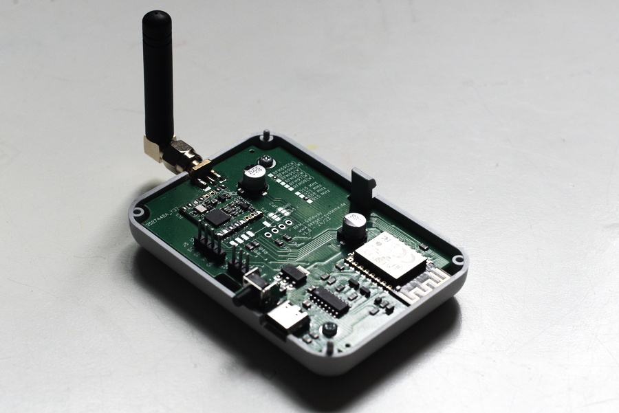

  
  
  
  

# RFM Gateway

RFM Gateway is a radio-to-WiFi bridge that connects HopeRF radio modules to an
ESP8266. It can receive RF data and forward it to your WiFi network, and it can
also send RF commands from HTTP or MQTT inputs.

Project description:
https://www.seegel-systeme.de/2023/09/15/rfm-wifi-gateway-a-radio-to-wifi-bridge/

Home Assistant forum:
https://community.home-assistant.io/t/rfm-gateway-a-sub-ghz-bridge-to-home-assistant/982886

## Highlights

- USB-C for power, flashing, and UART access
- Integrated USB programmer (no extra external programmer required)
- SMA antenna connector for the radio module
- Optional 0.96 inch I2C OLED support
- I2C and 1-wire extension headers

## Firmware capabilities

- 433 MHz RC pulse gateway (receive and transmit)
- 868 MHz sensor gateway (for supported sensor families)
- 868 MHz FS20 gateway
- Home Assistant integration via MQTT discovery

## Typical applications

- Bring wireless weather sensors into WiFi and MQTT
- Control RF sockets and remote controls
- Bridge RF nodes into home automation systems

## Repository structure

- [Firmware/](Firmware/): PlatformIO firmware project and web UI
- [custom_components/rfm_gateway/](custom_components/rfm_gateway/): Home Assistant custom integration
- [PCB/](PCB/): hardware design files
- [assets/](assets/): screenshots and images

## Home Assistant custom integration

The RFM Gateway integration connects Home Assistant directly to the gateway's
local HTTP API and provides a radio frequency transmitter. MQTT is not required
for this integration.

### Requirements

- Home Assistant 2026.5.0 or newer
- A gateway reachable from Home Assistant over the local network
- Firmware exposing `GET /api/rf/capabilities` and `POST /api/rf/transmit`
  (implemented by the RC pulse application in this repository)
- A radio module and antenna suitable for the devices you want to control

Compatibility depends on the firmware's RF API, not only its version number.
Check `http://<gateway-host>/api/rf/capabilities` for a JSON response containing
`supported_frequency_ranges` and `supported_modulations`. Replace
`<gateway-host>` with the gateway's hostname or IP address; include the port if
it is not 80.

### Installation

The repository can be added by link; being listed in the default catalog is not
required.

**Home Assistant 2026.11 and newer (Marketplace):**

1. Open **Settings > Marketplace > Add from link**.
2. Enter `https://github.com/Phunkafizer/RFM-gateway`.
3. Connect GitHub if prompted, and select **Integration** if asked for the type.
4. Open **RFM Gateway**, select **Install**, and continue with its setup flow.

**Home Assistant 2026.5 through 2026.10 (HACS):**

1. Install [HACS](https://www.hacs.xyz/docs/use/) if it is not already installed.
2. In HACS, open **Custom repositories** and add
   `https://github.com/Phunkafizer/RFM-gateway` with category **Integration**.
3. Download **RFM Gateway** and restart Home Assistant.
4. Open **Settings > Devices & services > Add integration**, then search for
   **RFM Gateway**.

**Manual installation:**

1. Copy the complete [custom_components/rfm_gateway/](custom_components/rfm_gateway/)
   folder into `<config>/custom_components/rfm_gateway/`, where `<config>` is
   the Home Assistant configuration directory.
2. Restart Home Assistant.
3. Open **Settings > Devices & services > Add integration** and select
   **RFM Gateway**.

When installing a release, make sure it contains the root-level
`custom_components/rfm_gateway/` folder and `hacs.json`. Older firmware-only
releases may not contain this layout.

### Configuration

Gateways advertising the matching `_http._tcp.local.` service and RF API
properties can be discovered automatically. Open **Settings > Devices &
services**, select the discovered gateway, and confirm setup.

For manual setup, enter:

| Setting | Description |
| --- | --- |
| Host | Gateway hostname or IP address, without `http://` or an API path |
| Port | HTTP API port; defaults to `80` |

Setup queries the gateway's capabilities before creating the integration.
No MQTT credentials or HTTP authentication settings are required.

### Supported functions and limitations

- Creates one radio frequency transmitter entity for each configured gateway.
- Sends raw RF commands through the gateway's HTTP transmit endpoint.
- Uses frequency ranges and modulations reported by the gateway.
- Can be used by compatible Home Assistant RF device integrations; it does not
  automatically create entities for every nearby RF device.
- This custom integration does not provide RF reception, sensor decoding, or
  MQTT discovery. The firmware's MQTT features are separate.
- Communication uses unencrypted local HTTP. Keep the gateway on a trusted
  network and do not expose its API to the internet.
- The transmitter becomes unavailable after a failed transmission and becomes
  available again after a successful transmission; it is not periodically polled.

### Troubleshooting

- **Cannot connect:** check the hostname/IP, HTTP port, gateway power, and network
  access from the machine running Home Assistant.
- **Invalid response:** check the capabilities URL above and ensure the firmware
  exposes the required RF API with valid capability data.
- **Transmit failure or unsupported modulation:** verify the gateway's reported
  capabilities and the radio module, antenna, and target-device protocol.
- **Not discovered:** add the gateway manually. Multicast discovery may not work
  across VLANs or routed networks.

For integration errors, check Home Assistant's logs under **Settings > System >
Logs** and report problems in the
[issue tracker](https://github.com/Phunkafizer/RFM-gateway/issues).

### Updates and removal

Install integration updates through Marketplace or HACS and restart Home
Assistant when prompted. For manual installations, replace the integration
folder with the new version and restart.

To remove a gateway, open its entry under **Settings > Devices & services** and
delete it. To remove the integration's files, also uninstall it in Marketplace
or HACS, or delete `<config>/custom_components/rfm_gateway/` for a manual
installation, then restart Home Assistant.

## Licensing

This repository uses a split-license model:

- Software/Firmware code: MIT, see [LICENSE](LICENSE)
- Hardware design files: CERN-OHL-S-2.0, see [LICENSE-HARDWARE](LICENSE-HARDWARE)
- Documentation and media assets: CC BY-SA 4.0, see [LICENSE-DOCS](LICENSE-DOCS)

### Preview

